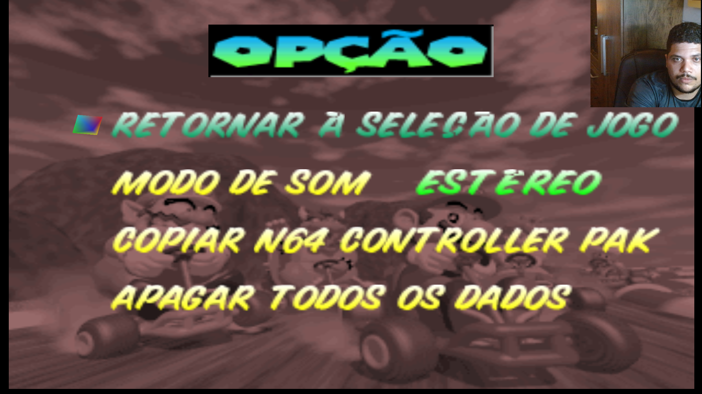
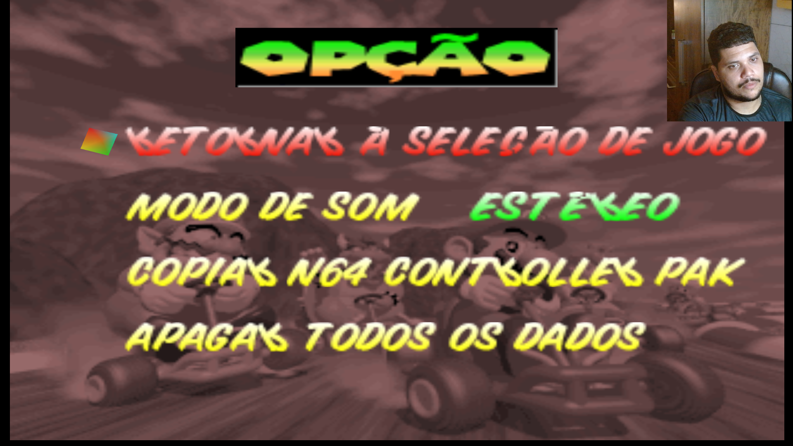
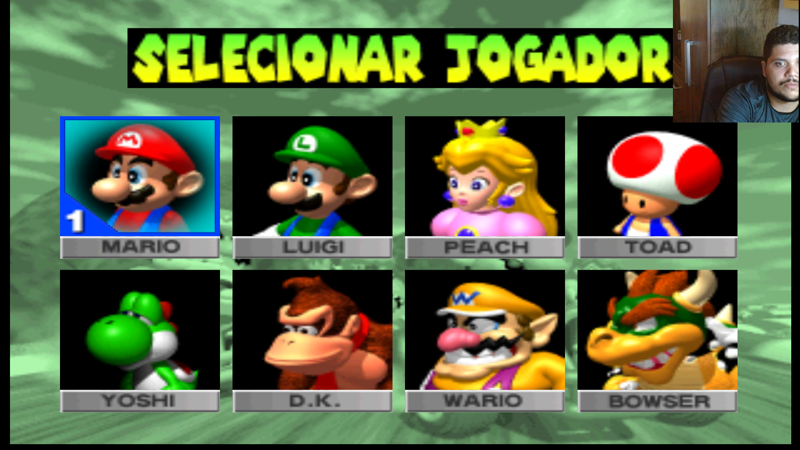
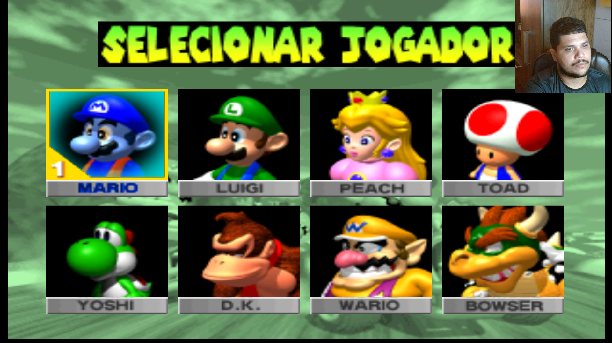
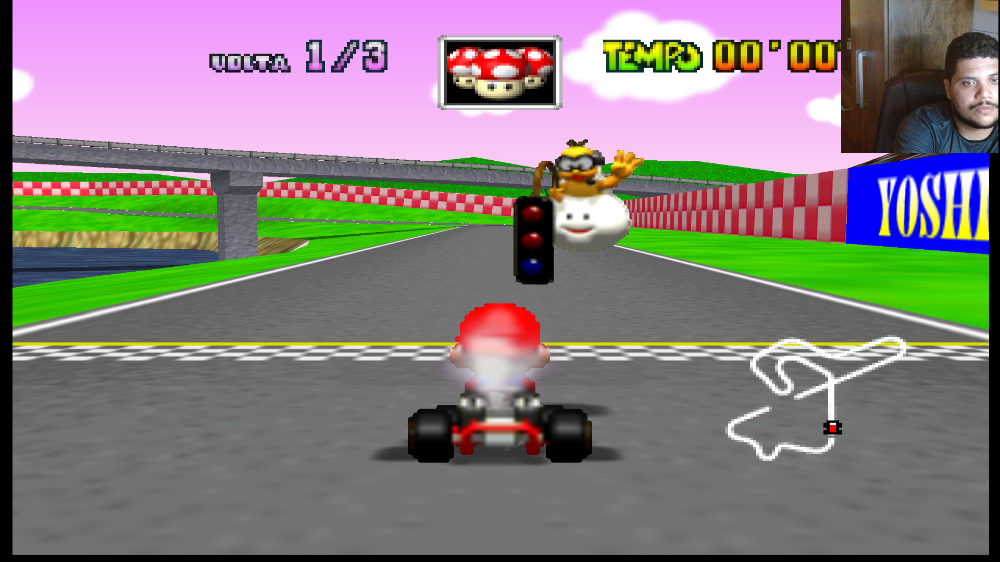
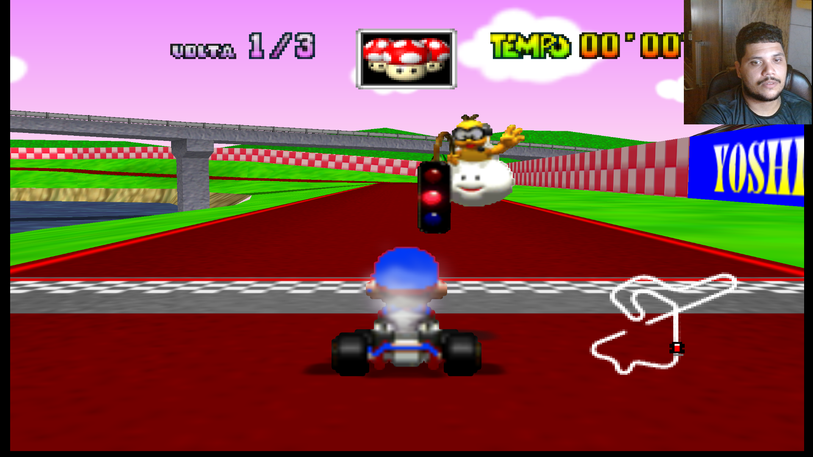
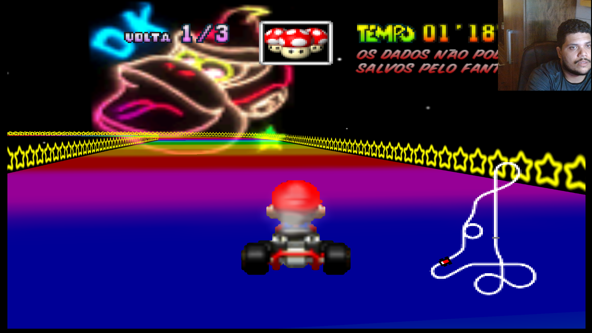
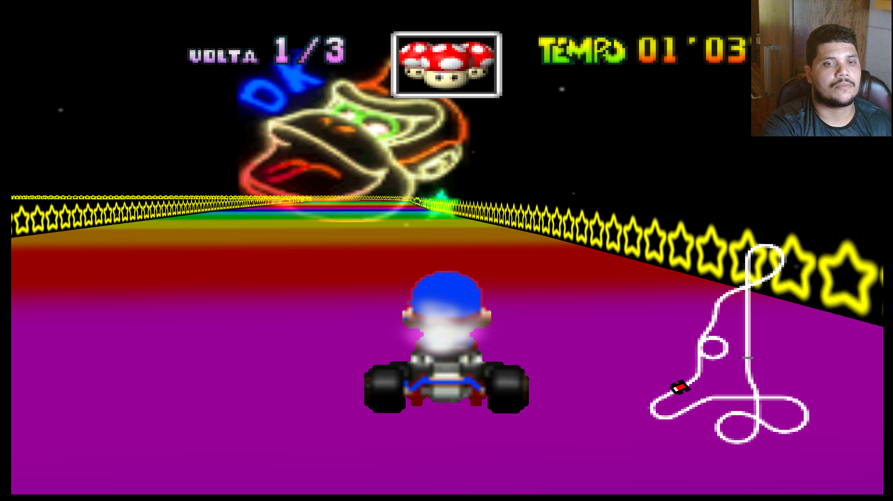

# MKart360 — Asset Editing & ROM Texture Tools

This repository brings together tools and workflows for editing textures and reinserting modified textures into a *Mario Kart 64* ROM, generating a new ROM with the changes applied. This work builds on the original decompilation project and the Xbox 360 port.

## Projects this work builds on

- **[n64decomp/mk64](https://github.com/n64decomp/mk64)** — the original *Mario Kart 64* decompilation project and its technical foundation.
- **[sirdankz/MKart360](https://github.com/sirdankz/MKart360)** — the *Mario Kart 64* port for Xbox 360.

## My work and how the projects fit together

I worked on the adaptations needed for the project to handle ROMs from different regions and languages. This involved making the necessary adjustments for versions that do not have exactly the same ROM layout or data. I also contributed to modifications related to the HD texture project.

The main work on the HD texture project is led by **[ffeliph999](https://github.com/ffeliph999) (Felipe)**, who is primarily responsible for that part and its graphical improvements. I made some contributions to those changes, but my responsibility was the texture extractor.

I am also responsible for the texture reinsertion tool and workflow. It takes the modified textures, reinserts their data into the ROM, and rebuilds the file to generate a new ROM with the changes applied. This is a separate part of the work from creating or editing the textures themselves.

## What this repository is for

This repository focuses on the tools and workflow for customizing your own *Mario Kart 64* ROM:

- Extract, edit, and replace game textures.
- Reinsert modified textures into the ROM and generate a rebuilt ROM.
- Work with ROMs from different regions and languages once the required version-specific adjustments have been made.
- Apply changes while respecting the ROM structure, texture formats and dimensions, palettes, and other technical limitations.
- Retain relevant graphical fixes developed during this work, including fixes for blank scoreboard/billboard screens and trees that were not displaying correctly.

This repository is **not simply a ready-made HD texture pack**. Its focus is on the tools and workflow for editing game assets and rebuilding the ROM. The result depends on the ROM version, the assets being modified, and the limitations of the game and the Xbox 360 port.

## Important limitations

Support for different ROMs, regions, and languages is not automatic for every version. ROMs may differ in their data, layout, assets, and other structural details. Depending on the ROM, you may need to adjust files, mappings, manifests, or build settings.

Texture dimensions, formats, palettes, and the way the game uses each asset also impose limitations. Increasing a texture's resolution does not guarantee that every replacement will work without additional adjustments.

Keep an untouched backup of your ROM and work only with ROM files you are legally entitled to use.

## Documentation

Step-by-step guides for the texture workflow:

- **[Texture Editing Guide — Portuguese (Brazil)](README_MKart360_Texturas_PT-BR.md)**
- **[Texture Editing Guide — English](README_MKart360_Texturas_EN.md)**

---

## 🖼️ Preview

### Original options

  

### Edited options

  

### Original character selection

  

### Edited character selection

  

### Original track

  

### Edited track

  

### Original karts and Rainbow Road frames

  

### Edited karts and Rainbow Road frames

  

---

## Credits and acknowledgements

- **[n64decomp/mk64](https://github.com/n64decomp/mk64)** — the original *Mario Kart 64* decompilation project and technical foundation.
- **[sirdankz/MKart360](https://github.com/sirdankz/MKart360)** — the Xbox 360 port.
- **[EduDicaseGameplay](https://github.com/EduDicaseGameplay)** — adaptations for ROMs from different regions and languages, the tool/workflow that reinserts modified textures into the ROM and rebuilds it, and contributions to the HD texture project.
- **[ffeliph999](https://github.com/ffeliph999)** — the lead contributor to the HD texture project and its graphical improvements and fixes.

This repository builds on the work of the original authors and contributors. Please refer to the upstream projects for their code, history, and licensing information.
